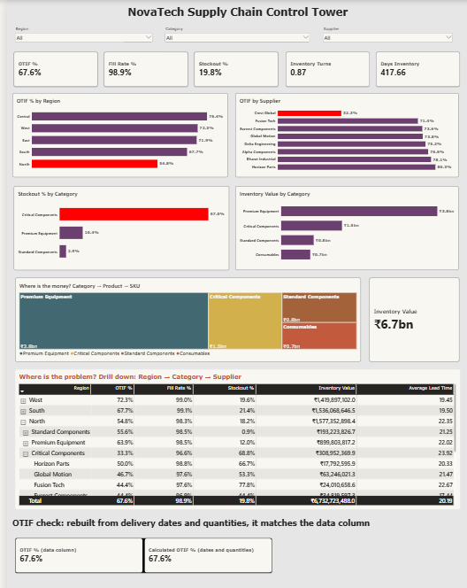

# NovaTech Supply Chain Control Tower (Power BI)

A one-page Power BI dashboard that shows whether NovaTech is serving its customers well while keeping inventory under control, and where the problem sits.

**Submitted by:** Goutam Singh Mandloi | **Batch:** 147 | **Course:** Data analysis with GEN AI

## The problem
The COO asked for one page, not 50 metrics: *are we serving customers well while controlling inventory, where is the problem, and what should management investigate?*

## Dashboard


## The 5 KPIs
| KPI | Value | Meaning |
|---|---|---|
| OTIF % | 67.6% | Orders delivered on time and in full |
| Fill Rate % | 98.9% | Units delivered vs units ordered |
| Stockout % | 19.8% | Orders that hit a stockout |
| Inventory Turns | 0.87 | How often stock is sold through |
| Days Inventory | 418 | Annualised days of stock held (365 / turns) |

## What the dashboard shows
- 3 slicers (Region, Category, Supplier) and 5 KPI cards
- OTIF by Region, OTIF by Supplier, Stockout % by Category, Inventory Value by Category
- Inventory value card and treemap (Category, Product, SKU)
- Drill-down matrix: Region, then Category, then Supplier (OTIF, Fill Rate, Stockout, Inventory Value, Lead Time)
- OTIF check: the OTIF column in the data vs OTIF rebuilt from delivery dates and quantities (both 67.6%)

## Key findings
- **Service is the problem, not inventory volume.** Fill Rate is 98.9% but OTIF is only 67.6%.
- **Region:** North is weakest (54.8% OTIF). It is also weaker than other regions without Crest Global (61.8% vs 75 to 85%).
- **Category:** Critical Components has 67% stockouts and 45% OTIF.
- **Supplier:** Crest Global has 32% OTIF (others 71 to 80%). It is late (58% on time) and short (59% in full), and it supplies the most Critical Components orders.
- **Working capital:** Premium Equipment holds about Rs 377 Cr, 56% of the Rs 673 Cr total.
- **OTIF trap:** on-time (81.4%) and in-full (81.5%) both look fine, but only 67.6% of orders are both.

## Recommended action
Put Crest Global on a supplier recovery plan, starting with Critical Components, and qualify a second supplier. More stock is not the answer: Critical Components already hold Rs 147 Cr and still run out in 67% of orders.

Full write-up: [NovaTech_Final_Report.docx](NovaTech_Final_Report.docx)

## DAX measures used
```DAX
Total Orders = COUNTROWS('Supply_Chain_Data')
OTIF Orders = CALCULATE(COUNTROWS('Supply_Chain_Data'), 'Supply_Chain_Data'[OTIF] = "Yes")
OTIF % = DIVIDE([OTIF Orders], [Total Orders], 0)
Fill Rate % = DIVIDE([Total Delivered Qty], [Total Ordered Qty], 0)
Stockout % = DIVIDE([Stockout Events], [Total Orders], 0)
COGS = SUMX('Supply_Chain_Data', 'Supply_Chain_Data'[Delivered Qty] * 'Supply_Chain_Data'[Unit Cost (INR)])
Inventory Turns = DIVIDE([COGS], [Average Inventory Value], 0)
Days Inventory = DIVIDE(365, [Inventory Turns], 0)
Calculated OTIF Orders =
CALCULATE(COUNTROWS('Supply_Chain_Data'),
  FILTER('Supply_Chain_Data',
    'Supply_Chain_Data'[Delivery Date] <= 'Supply_Chain_Data'[Requested Date]
    && 'Supply_Chain_Data'[Delivered Qty] >= 'Supply_Chain_Data'[Order Qty]))
```

## Files
| File | Purpose |
|---|---|
| `NovaTech_Supply_Chain.pbix` | Power BI report (open in Power BI Desktop) |
| `NovaTech_Supply_Chain_Analytics_Dataset.csv` | Source data |
| `dashboard.png` | Dashboard screenshot |
| `NovaTech_Final_Report.docx` | Final report |

## Tools
Power BI Desktop, Power Query, DAX
